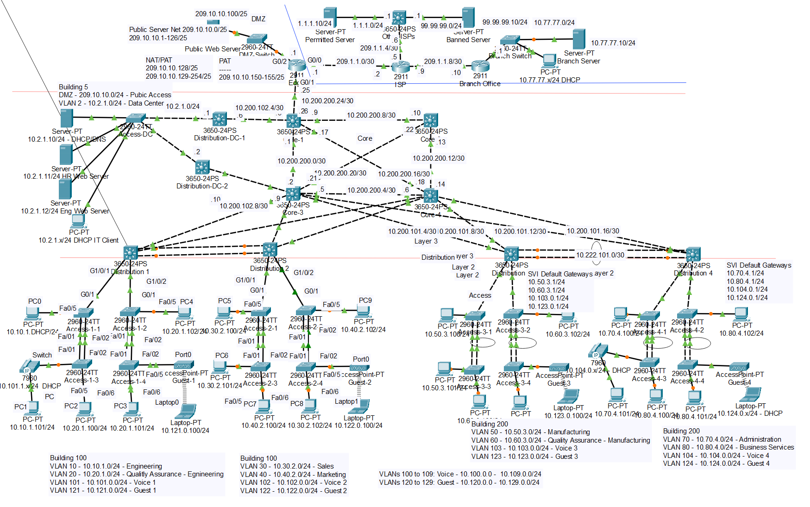
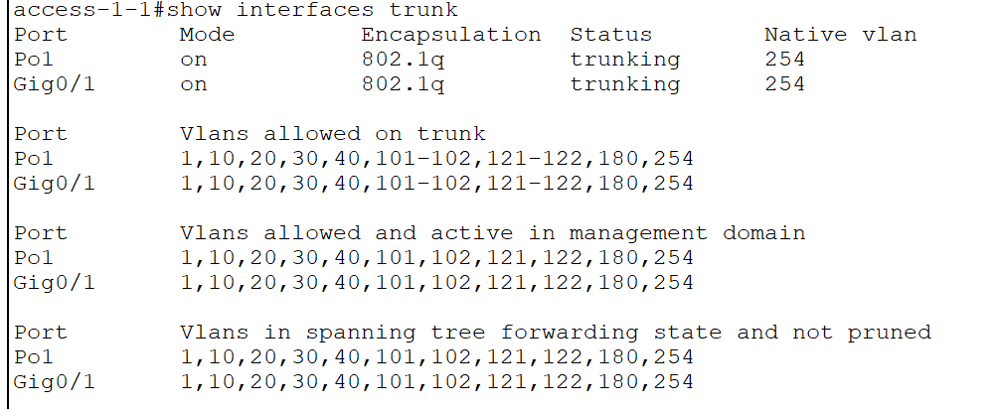
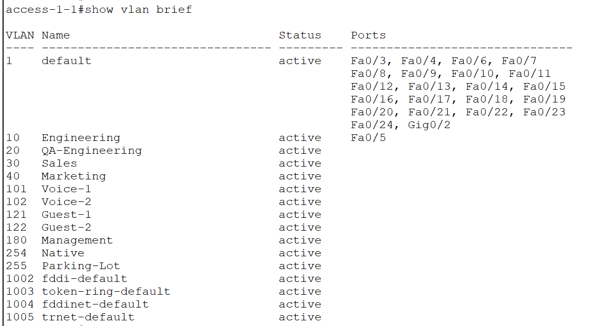

# Enterprise Network Design and Configuration

*Suggested screenshot: The completed initial topology showing the switches, end devices, and network connections.*

---
**Tools:** Cisco Packet Tracer, Cisco IOS CLI  
**Project Type:** Networking Lab / Personal Portfolio Project  
**Focus:** Enterprise switching, VLANs, routing, redundancy, and troubleshooting

## Project Overview

This project involved building and configuring a simulated enterprise network in Cisco Packet Tracer. The goal was to expand an existing network by adding access switches, distribution switches, end devices, and wireless networks while maintaining connectivity across different network segments.

Throughout the project, I practiced configuring Cisco switches, segmenting networks with VLANs, enabling inter-VLAN routing, configuring routed links, implementing EtherChannel, and connecting the distribution layer to the core network.

The project helped me develop practical networking skills and a better understanding of how enterprise networks are designed, configured, and troubleshot.

## Technologies and Concepts

- Cisco Packet Tracer
- Cisco IOS command-line interface (CLI)
- IPv4 addressing and subnetting
- VLANs and trunking
- Switch Virtual Interfaces (SVIs)
- Inter-VLAN routing
- Static routing and OSPF fundamentals
- Layer 2 and Layer 3 EtherChannel
- Link Aggregation Control Protocol (LACP)
- Spanning Tree Protocol (STP) and Rapid STP (RSTP)
- DHCP and wireless networking
- Network connectivity testing and troubleshooting

---

## Part 1: Basic Ethernet and IP Networking

### What I Did

- Built out the initial network topology using access switches, multilayer switches, PCs, laptops, an IP phone, and wireless access points.
- Connected devices using the required cable types and switch ports.
- Configured IPv4 addresses, subnet masks, default gateways, and DNS settings for end devices.
- Configured wireless access points with separate guest SSIDs and connected laptops to their respective wireless networks.
- Tested connectivity between devices on the same subnet and examined why devices on different networks could not communicate without routing.

### Troubleshooting and Lessons Learned

- Checked physical connections and interface status when links did not come online.
- Learned that certain Packet Tracer devices, including multilayer switches and the IP phone, require power supplies to be installed.
- Used `ping` to distinguish successful local communication from communication that requires Layer 3 routing.

## Part 2: VLANs and Trunks

### What I Did

- Configured switch hostnames and basic device management settings through the Cisco IOS CLI.
- Created and named VLANs for Engineering, QA, Sales, Marketing, Voice, Guest, Management, Native, and Parking Lot networks.
- Assigned end-device switch ports to the appropriate access VLANs.
- Configured trunk links to carry traffic for multiple VLANs between switches.
- Configured voice VLAN settings for the switch port connected to an IP phone.
- Used commands such as `show vlan` and `show interfaces trunk` to verify configurations.

### Troubleshooting and Lessons Learned

- Investigated VLAN mismatches that could cause Spanning Tree Protocol warnings and blocked ports.
- Learned that creating a VLAN does not automatically assign switch ports to it.
- Practiced checking access port assignments and trunk configurations when devices could not communicate as expected.

## Part 3: Switch Virtual Interfaces (SVIs)

### What I Did

- Configured Switch Virtual Interfaces to provide IP addresses for VLANs.
- Configured management addressing on switches where required.
- Set up SVIs on multilayer switches to act as default gateways for their respective VLANs.
- Enabled Layer 3 routing on the multilayer switches.
- Verified interface status and tested communication between devices in different VLANs.

### Troubleshooting and Lessons Learned

- Learned the difference between a VLAN operating at Layer 2 and an SVI providing a Layer 3 interface.
- Checked that the correct VLANs and IP addresses were configured.
- Used interface status and connectivity tests to help identify routing or configuration issues.

### Screenshot

*Suggested screenshot: The `show ip interface brief` output displaying configured SVIs and their interface status.*

---

## Part 4: Routed Ports and Routing

### What I Did

- Configured routed interfaces on multilayer switches by using the `no switchport` command.
- Assigned IPv4 addresses to routed links connecting the distribution switches.
- Configured static routes to provide reachability between remote networks.
- Examined routing tables to understand how traffic was forwarded between subnets.
- Used `ping` and `tracert` to verify end-to-end connectivity and observe the path traffic took through the network.

### Troubleshooting and Lessons Learned

- Checked IP addresses, subnet masks, interface status, and routing table entries when connectivity failed.
- Learned that a routed interface differs from a Layer 2 switchport because it can have its own IP address.
- Used traceroute results to confirm that traffic was passing through the expected Layer 3 devices.

## Part 5: EtherChannel and Spanning Tree Protocol

### What I Did

- Examined the initial Spanning Tree Protocol state of redundant switch links.
- Configured Layer 2 EtherChannel using LACP to combine multiple physical links into a logical port channel.
- Examined how EtherChannel affected Spanning Tree behavior and link forwarding.
- Verified trunking and VLAN propagation across port channels.
- Configured Layer 3 EtherChannel between distribution switches.
- Verified port-channel status and network connectivity using Cisco IOS commands.

### Troubleshooting and Lessons Learned

- Learned that EtherChannel member interfaces must have compatible configurations on both ends.
- Practiced checking interface settings, LACP negotiation, and port-channel status when links did not bundle correctly.
- Encountered a documented Packet Tracer limitation in which allowed VLAN settings might not appear correctly on the logical port-channel interface. The lab describes applying the allowed VLAN configuration directly to the port-channel interface as a workaround.

## Part 6: Connecting the Distribution Layer to the Core

This stage extended the enterprise network by connecting the distribution switches to the core switches.

### What I Did

- Examined the existing distribution-layer configuration and routing.
- Connected distribution switches to core switches using the specified interfaces.
- Prepared routed links for communication between the distribution and core layers.
- Verified the physical connections and interface status before configuring routing.

### Troubleshooting and Lessons Learned

- Checked cable connections, interface selection, and link status when validating the new connections.
- Learned how the core layer connects different parts of an enterprise network and provides paths toward other networks.

## Part 7: Routed Interface Addressing and Connectivity

### What I Did

- Configured IPv4 addresses on the routed links between the distribution and core switches.
- Used the provided addressing plan to configure the point-to-point connections.
- Verified interface status and checked that the configured IP addresses were correct.
- Tested IP connectivity between directly connected network devices.

### Troubleshooting and Lessons Learned

- Practiced checking interface status and IP addressing when a routed link was not operational.
- Learned the importance of assigning compatible IP addresses and subnet masks to both ends of a point-to-point link.
- Used connectivity tests to verify that the physical and Layer 3 configurations were working together.

## Part 8: OSPF Configuration and Final Verification

### What I Did

- Introduced dynamic routing by configuring OSPF on the distribution switches to communicate with each other and the core routers.
- Examined OSPF participation on the routed interfaces.
- Reviewed routing information to understand how remote networks could be learned dynamically.
- Removed the existing static routes where required by the lab instructions.
- Tested connectivity between enterprise networks and the external server to verify the completed network.

### Troubleshooting and Lessons Learned

- Learned that OSPF requires compatible configurations and operational interfaces to establish routing adjacencies.
- Practiced checking routing information and network reachability when validating dynamic routing.
- Reviewed documented Packet Tracer limitations involving certain OSPF commands on Layer 3 port channels and route selection. These limitations can affect the simulated results even when the intended configuration has been applied.

## Key Takeaways

This project gave me hands-on practice with several foundational enterprise networking technologies. I gained experience with:

- Configuring and troubleshooting Cisco switches through the CLI.
- Designing VLANs and trunk links to separate network traffic.
- Enabling communication between VLANs using Layer 3 switching.
- Configuring routed links and static routing.
- Implementing link aggregation with LACP and understanding Spanning Tree behavior.
- Connecting distribution switches to the core and practicing OSPF.
- Verifying network behavior using `ping`, `tracert`, `show ip route`, `show vlan`, and other Cisco IOS commands.

The project strengthened my understanding of enterprise network architecture and gave me a practical environment to apply networking concepts.

## Project Environment

This project was completed in Cisco Packet Tracer as a simulated networking lab. The configurations and results demonstrate academic and hands-on lab experience rather than a production network deployment.
